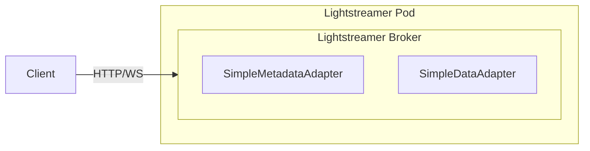

# In-Process Adapter example

This example demonstrates how to deploy the Lightstreamer Helm chart with **In-Process Adapters**, where the adapter logic runs inside the Lightstreamer JVM as part of the server process.

## Architecture



Lightstreamer is configured with:
- an **In-Process** Metadata Adapter (`SimpleMetadataAdapter`)
- an **In-Process** Data Adapter (`SimpleDataAdapter`)

Both adapters are compiled into a JAR and baked into a custom Docker image that extends the official Lightstreamer image.

## The Adapter Set example project

The [`example-adapter-set/`](example-adapter-set/) folder is a self-contained Gradle project that produces a sample Hello World–style Adapter Set with two adapters:

- `SimpleMetadataAdapter` (extends `LiteralBasedProvider`): handles client authentication and item validation
- `SimpleDataAdapter`: generates sample real-time data (alternating "Hello" / "World" messages)

The project is organized as follows:

```sh
example-adapter-set/
├── src/main/java/…               # Java adapter source code
├── build.gradle                   # Gradle build — compiles and assembles the adapter JAR
├── Dockerfile                     # Extends the official Lightstreamer image
├── index.html                     # Test page — subscribes to the example Adapter Set
├── build.sh                       # Build + package + push (Kubernetes or OpenShift)
└── undeploy.sh                    # Clean up images and cluster resources
```

**Build pipeline**: `build.sh` automates the full chain:

1. Runs `gradlew build`, which compiles the adapter classes and assembles them into `build/libs/example-adapter-set-1.0.0.jar`.
2. Builds a Docker image using the Dockerfile, which copies the compiled adapter and the test page into the Lightstreamer image:
   ```dockerfile
   FROM lightstreamer
   COPY build/libs/example-adapter-set-1.0.0.jar /lightstreamer/adapters/example-adapter-set/lib/
   COPY index.html /lightstreamer/pages/index.html
   ```
3. Pushes the image to the target registry (or triggers an OpenShift server-side build).

You can use this project as a starting point for your own adapters: replace the source code under `src/`, adjust `build.gradle`, and follow the deployment steps below.

## Prerequisites

- A running Kubernetes cluster with `kubectl` configured, or an OpenShift cluster with `oc` available
- `helm` on your PATH
- The Lightstreamer Helm repository added:
  ```sh
  helm repo add lightstreamer https://lightstreamer.github.io/helm-charts
  helm repo update
  ```
- A container registry accessible by the cluster nodes (e.g. Docker Hub, a private registry, or a local registry), required for the `kubernetes` target
- `docker` on your PATH for local image builds
- A Java JDK (17+) for building the Adapter Set with Gradle
- A namespace named `lightstreamer` (called a "project" on OpenShift). The Helm chart deploys into it. Create it with `kubectl create namespace lightstreamer` or, on OpenShift, `oc new-project lightstreamer`; ask your cluster admin if you don't have permission. Any name can be used, provided you pass it consistently to `helm install --namespace ...`.

## Deployment

### 1. Build the custom image

From the [`example-adapter-set/`](example-adapter-set/) folder, run `build.sh` with the appropriate target:

```sh
cd example-adapter-set/
```

- **Any Kubernetes distribution**: build and push the image to a registry accessible by your cluster nodes:
  ```sh
  REGISTRY=myregistry.example.com/myorg ./build.sh kubernetes
  ```
  Set `REGISTRY` to the prefix of your container registry. The image will be tagged and pushed as `${REGISTRY}/lightstreamer-example-adapter-set:1.0.0`.

  > **Minikube shortcut**: If you are using Minikube for local development you can avoid a remote registry entirely by pointing your shell at Minikube's built-in Docker daemon before running the script. The image is then built directly inside Minikube and no push is needed:
  > ```sh
  > eval $(minikube docker-env)
  > ./build.sh kubernetes
  > ```
  > Run `eval $(minikube docker-env --unset)` to restore your shell's Docker environment afterwards.

- **OpenShift**: no local Docker build is needed. The script uploads the source directory and triggers a server-side build via a binary BuildConfig:
  ```sh
  ./build.sh openshift
  ```

At the end, the script prints the `image.repository` and `image.tag` values to set in your Helm values file.

### 2. Install the Lightstreamer Helm chart

Install the chart using the provided [`values.yaml`](values.yaml), overriding the image to point to the custom image built in the previous step:

- **Any Kubernetes distribution**: use the image reference from your registry:
  ```sh
  helm install lightstreamer lightstreamer/lightstreamer \
    -f ../values.yaml \
    --set image.repository=lightstreamer-example-adapter-set \
    --set image.tag=1.0.0 \
    --namespace lightstreamer
  kubectl rollout status deployment/lightstreamer -n lightstreamer
  kubectl logs -l app.kubernetes.io/name=lightstreamer -n lightstreamer
  ```

- **OpenShift**: use the image reference printed by `build.sh`, for example:
  ```sh
  helm install lightstreamer lightstreamer/lightstreamer \
    -f ../values.yaml \
    --set image.repository=image-registry.openshift-image-registry.svc:5000/lightstreamer/lightstreamer-example-adapter-set \
    --set image.tag=1.0.0 \
    --namespace lightstreamer
  oc rollout status deployment/lightstreamer -n lightstreamer
  oc logs -l app.kubernetes.io/name=lightstreamer -n lightstreamer
  ```

Check the logs to confirm the Adapter Set has loaded successfully.

The provided [`values.yaml`](values.yaml) defines the Adapter Set with the two In-Process Adapters (`SimpleMetadataAdapter` and `SimpleDataAdapter`) and provisions them from the path baked into the custom image.

## Accessing the web client

To access the [`index.html`](example-adapter-set/index.html) web client, served by Lightstreamer's built-in web server, forward the Service port to your machine:

- **Any Kubernetes distribution**:
  ```sh
  kubectl port-forward svc/lightstreamer-service 8080:8080 -n lightstreamer
  ```

- **OpenShift**:
  ```sh
  oc port-forward svc/lightstreamer-service 8080:8080 -n lightstreamer
  ```

Then open <http://127.0.0.1:8080/index.html>. The provided [`values.yaml`](values.yaml) allows the `http://127.0.0.1:8080` origin, so the page can connect to Lightstreamer.

> [!NOTE]
> Port forwarding is intended for local testing only, as it tunnels traffic through the Kubernetes API server and lasts only as long as the command runs. To make Lightstreamer reachable by real clients, expose the Service through an Ingress or a load balancer.

## Cleanup

The steps below remove only the resources created by this example. The `lightstreamer` namespace/project is left in place, so this workflow is safe on shared or admin-provisioned projects where you don't have delete rights.

Uninstall the Helm chart first to stop the Pods:

```sh
helm uninstall lightstreamer --namespace lightstreamer
```

Then remove the image build resources from the [`example-adapter-set/`](example-adapter-set/) folder:

- **Any Kubernetes distribution**:
  ```sh
  REGISTRY=myregistry.example.com/myorg ./undeploy.sh kubernetes
  ```
  Removes the local Docker image (if `REGISTRY` is set).

  > **Minikube shortcut**: If you built the image inside Minikube's Docker daemon, point your shell at it again before running the script so that the image is removed from the correct daemon:
  > ```sh
  > eval $(minikube docker-env)
  > ./undeploy.sh kubernetes
  > ```
  > Run `eval $(minikube docker-env --unset)` to restore your shell's Docker environment afterwards.

- **OpenShift**:
  ```sh
  ./undeploy.sh openshift
  ```
  Removes the BuildConfig and ImageStream from the cluster.
