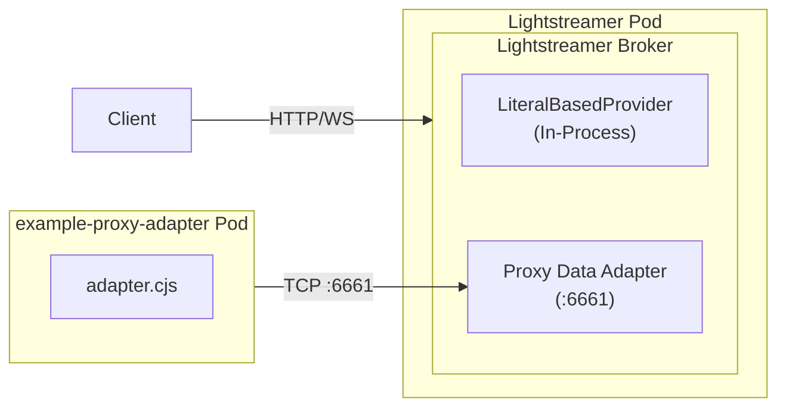

# Proxy Adapter example

This example demonstrates how to deploy the Lightstreamer Helm chart with a **Proxy Data Adapter**, which delegates data production to a separate Remote Adapter process running in its own Kubernetes pod.

## Architecture



Lightstreamer is configured with:
- an **In-Process** Metadata Adapter (`LiteralBasedProvider`, provided by the Lightstreamer SDK)
- a **Proxy Data Adapter** listening on port `6661` for incoming connections from the Remote Adapter

The Node.js Remote Adapter connects to Lightstreamer on port `6661` and pushes Hello World–style real-time data (alternating "Hello" / "World" messages), as configured by the arguments in [`deployment.yaml.tmpl`](example-proxy-adapter-set/deployment.yaml.tmpl):

```yaml
args:
  - lightstreamer-adapters.lightstreamer.svc   # Lightstreamer service hostname
  - "6661"                                     # Proxy adapter port
```

## The Remote Adapter example project

The [`example-proxy-adapter-set/`](example-proxy-adapter-set/) folder contains a Node.js Remote Adapter that produces sample real-time data. The project is organized as follows:

```sh
example-proxy-adapter-set/
├── adapter.cjs                          # Node.js adapter source code
├── Dockerfile                           # Packages the adapter into a container
├── deployment.yaml.tmpl                 # Kubernetes Deployment manifest template
├── index.html                           # Test page — subscribes to the example Adapter Set
├── build.sh                             # Build + package (Kubernetes or OpenShift)
└── undeploy.sh                          # Clean up deployment and images
```

**Build pipeline**: `build.sh` automates the full chain:

1. Builds a Docker image using the Dockerfile, which installs the `lightstreamer-adapter` NPM package into a Node.js base image and copies the adapter source:
   ```dockerfile
   FROM node
   WORKDIR /app
   COPY adapter.cjs /app
   RUN cd /app && npm install lightstreamer-adapter
   ENTRYPOINT ["node", "adapter.cjs"]
   ```
2. Pushes the image to the target registry (or triggers an OpenShift server-side build).

## Prerequisites

- A running Kubernetes cluster with `kubectl` configured, or an OpenShift cluster with `oc` available
- `helm` on your PATH
- The Lightstreamer Helm repository added:
  ```sh
  helm repo add lightstreamer https://lightstreamer.github.io/helm-charts
  helm repo update
  ```
- A container registry accessible by the cluster nodes (e.g. Docker Hub, a private registry, or a local registry), required for the `kubernetes` target
- `docker` on your PATH for local image builds
- A namespace named `lightstreamer` (called a "project" on OpenShift). All resources deploy into it. Create it with `kubectl create namespace lightstreamer` or, on OpenShift, `oc new-project lightstreamer`; ask your cluster admin if you don't have permission. To use a different name, update [`deployment.yaml.tmpl`](example-proxy-adapter-set/deployment.yaml.tmpl) to match, as the namespace is part of the Lightstreamer service DNS hostname the Remote Adapter connects to.

## Deployment

### 1. Build the Remote Adapter image

From the [`example-proxy-adapter-set/`](example-proxy-adapter-set/) folder, run `build.sh` with the appropriate target. Optionally edit [`adapter.cjs`](example-proxy-adapter-set/adapter.cjs) beforehand to customise the adapter logic.

```sh
cd example-proxy-adapter-set/
```

- **Any Kubernetes distribution**: build and push the image to a registry accessible by your cluster nodes:
  ```sh
  REGISTRY=myregistry.example.com/myorg ./build.sh kubernetes
  ```
  Set `REGISTRY` to the prefix of your container registry. The image will be tagged and pushed as `${REGISTRY}/example-proxy-adapter:1.0.0`.

  > **Minikube shortcut**: If you are using Minikube for local development you can avoid a remote registry entirely by pointing your shell at Minikube's built-in Docker daemon before running the script. The image is then built directly inside Minikube and no push is needed:
  > ```sh
  > eval $(minikube docker-env)
  > ./build.sh kubernetes
  > ```
  > Run `eval $(minikube docker-env --unset)` to restore your shell's Docker environment afterwards.

- **OpenShift**: no local Docker build is needed. The script uploads the source directory and triggers a server-side build via a binary BuildConfig:
  ```sh
  ./build.sh openshift
  ```

At the end, the script prints the command to deploy the Remote Adapter (used in step 3).

### 2. Install the Lightstreamer Helm chart

Create a ConfigMap from the [`index.html`](example-proxy-adapter-set/index.html) web client, which the provided [`values.yaml`](values.yaml) mounts as the root of Lightstreamer's built-in web server:

- **Any Kubernetes distribution**:
  ```sh
  kubectl create configmap example-proxy-adapter-pages --from-file=index.html -n lightstreamer
  ```

- **OpenShift**:
  ```sh
  oc create configmap example-proxy-adapter-pages --from-file=index.html -n lightstreamer
  ```

Then install the chart using the provided [`values.yaml`](values.yaml), which configures the Proxy Data Adapter:

- **Any Kubernetes distribution**:
  ```sh
  helm install lightstreamer lightstreamer/lightstreamer \
    -f ../values.yaml \
    --namespace lightstreamer
  kubectl rollout status deployment/lightstreamer -n lightstreamer
  kubectl logs -l app.kubernetes.io/name=lightstreamer -n lightstreamer
  ```

- **OpenShift**:
  ```sh
  helm install lightstreamer lightstreamer/lightstreamer \
    -f ../values.yaml \
    --namespace lightstreamer
  oc rollout status deployment/lightstreamer -n lightstreamer
  oc logs -l app.kubernetes.io/name=lightstreamer -n lightstreamer
  ```

Check the logs to confirm the Proxy Data Adapter is listening on port `6661`.

The provided [`values.yaml`](values.yaml) defines an Adapter Set with an In-Process Metadata Adapter (`LiteralBasedProvider`, provided by the Lightstreamer SDK) and a Proxy Data Adapter listening on port `6661` for incoming connections from the Remote Adapter.

### 3. Deploy the Remote Adapter

Once Lightstreamer is running and the Proxy Data Adapter is ready to accept connections, deploy the Remote Adapter by running the command printed by `build.sh` in step 1. For example:

- **Any Kubernetes distribution**:
  ```sh
  IMAGE_REF=example-proxy-adapter:1.0.0 envsubst '${IMAGE_REF}' < deployment.yaml.tmpl | kubectl apply -f -
  kubectl rollout status deployment/example-proxy-adapter -n lightstreamer
  kubectl logs -l app=example-proxy-adapter -n lightstreamer
  ```

- **OpenShift**: use the image reference printed by `build.sh`, for example:
  ```sh
  IMAGE_REF=image-registry.openshift-image-registry.svc:5000/lightstreamer/example-proxy-adapter:1.0.0 envsubst '${IMAGE_REF}' < deployment.yaml.tmpl | kubectl apply -f -
  oc rollout status deployment/example-proxy-adapter -n lightstreamer
  oc logs -l app=example-proxy-adapter -n lightstreamer
  ```

This generates the Deployment manifest from [`deployment.yaml.tmpl`](example-proxy-adapter-set/deployment.yaml.tmpl) with the resolved image reference and applies it to the cluster. The Remote Adapter pod will start and connect to Lightstreamer on port `6661`. Check the logs to confirm the Remote Adapter has connected successfully.

## Accessing the web client

To access the [`index.html`](example-proxy-adapter-set/index.html) web client, served by Lightstreamer's built-in web server, forward the service port to your machine:

- **Any Kubernetes distribution**:
  ```sh
  kubectl port-forward svc/lightstreamer-service 8080:8080 -n lightstreamer
  ```

- **OpenShift**:
  ```sh
  oc port-forward svc/lightstreamer-service 8080:8080 -n lightstreamer
  ```

Then open <http://127.0.0.1:8080/index.html>. The provided [`values.yaml`](values.yaml) allows the `http://127.0.0.1:8080` origin, so the page can connect to Lightstreamer.

> [!NOTE]
> Port forwarding is intended for local testing only, as it tunnels traffic through the Kubernetes API server and lasts only as long as the command runs. To make Lightstreamer reachable by real clients, expose the service through an Ingress or a load balancer.

## Cleanup

The steps below remove only the resources created by this example. The `lightstreamer` namespace/project is left in place, so this workflow is safe on shared or admin-provisioned projects where you don't have delete rights.

Uninstall the Helm chart first to stop the pods, then remove the web client ConfigMap:

```sh
helm uninstall lightstreamer --namespace lightstreamer
kubectl delete configmap example-proxy-adapter-pages -n lightstreamer
```

Then remove the Node.js adapter resources from the [`example-proxy-adapter-set/`](example-proxy-adapter-set/) folder:

- **Any Kubernetes distribution**:
  ```sh
  REGISTRY=myregistry.example.com/myorg ./undeploy.sh kubernetes
  ```
  Deletes the Node.js adapter deployment and removes the local Docker image (if `REGISTRY` is set).

  > **Minikube shortcut**: If you built the image inside Minikube's Docker daemon, point your shell at it again before running the script so that the image is removed from the correct daemon:
  > ```sh
  > eval $(minikube docker-env)
  > ./undeploy.sh kubernetes
  > ```
  > Run `eval $(minikube docker-env --unset)` to restore your shell's Docker environment afterwards.  

- **OpenShift**:
  ```sh
  ./undeploy.sh openshift
  ```
  Deletes the Node.js adapter deployment, the BuildConfig, and the ImageStream from the cluster.

